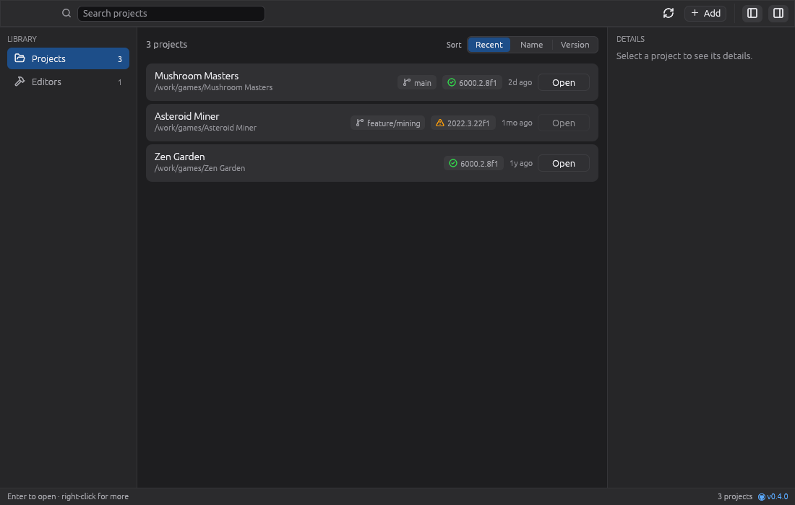

# Rusty Hub [](https://github.com/Leinnan/rusty_hub/actions/workflows/rust.yml)

https://www.mevlyshkin.com/projects/rusty_unity_hub/


A small alternative to the Unity Hub, written in Rust with [egui](https://github.com/emilk/egui).



- Find projects by scanning a folder, dropping one on the window, or importing the Unity Hub's list
- Search and sort them, and see at a glance which ones have their editor installed
- Open a project in the editor it asks for, or any other installed one

## Download

There is ready to download Windows version. Go to [Releases](https://github.com/Leinnan/rusty_hub/releases) and look for `windows-build.zip` in `Assets`.

## Building and using

[Cargo](https://doc.rust-lang.org/cargo/getting-started/installation.html) is required in order to build it.

```sh
git clone git@github.com:Leinnan/rusty_hub.git
cd rusty_hub
cargo run --release
```

Recipes for development live in the [justfile](justfile) (`cargo install just`):

```sh
just run         # debug build
just validate    # format check, tests, clippy, and checks for the other desktop targets
just snapshots   # re-record the UI snapshot images in tests/snapshots
```

## Layout

| Path | Contents |
|---|---|
| `assets/icon/icon.svg` | The app icon; `build.rs` renders the PNG and ICO from it |
| `crates/unity-hub` | Finds Unity editors and projects on disk; knows nothing about the UI |
| `src/app` | The application: applies commands and lays out the panels |
| `src/ui` | Theme, widgets, panels and pages |
| `src/commands.rs` | What widgets ask the app to do |
| `src/jobs.rs` | Background work that walks the disk |
| `src/tests` | Headless UI tests with `egui_kittest` |

## Thanks

Big thanks to https://github.com/unitycoder/UnityLauncherPro 

Most of the required information about how data is stored by Unity HUB is taken from there.
